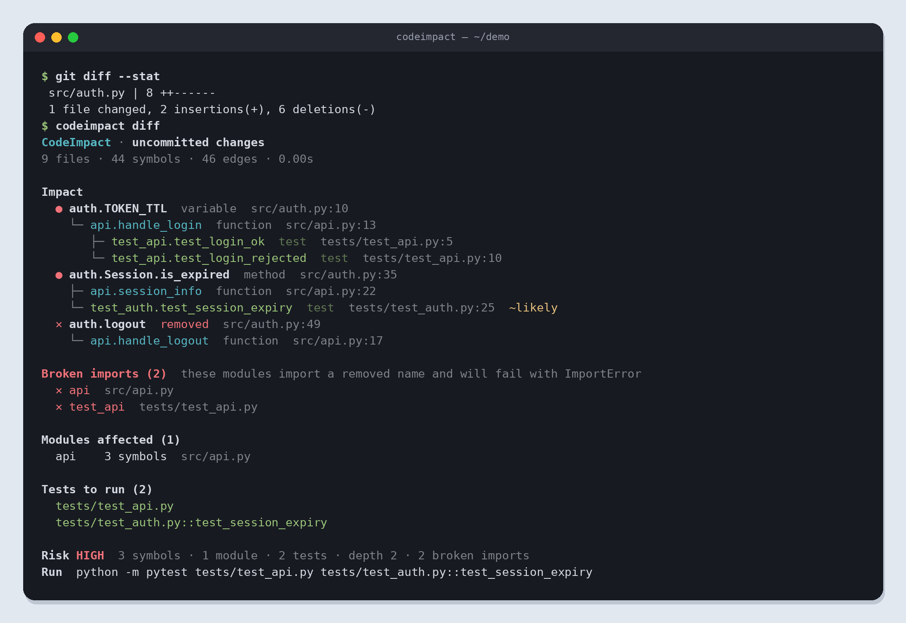
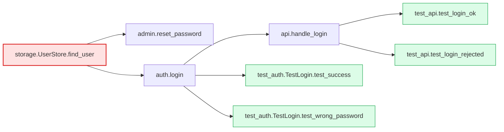

<div align="center">

# CodeImpact

**Change one function — see everything it breaks.**

Static change-impact analysis for Python. CodeImpact builds a call/reference graph of your project from the AST, walks it backwards from the code you touched, and tells you which functions, classes and modules depend on it — and exactly which pytest tests to run.

[](.github/workflows/ci.yml)


[](LICENSE)

[Русская версия](README.ru.md)

</div>

```text
$ codeimpact analyze src/auth.py -f hash_password

CodeImpact · src/auth.py
9 files · 45 symbols · 47 edges · 0.01s

Impact
  ● auth.hash_password  function  src/auth.py:18
    ├─ admin.create_user  function  src/admin.py:7
    │  └─ conftest.store  fixture  tests/conftest.py:11
    │     ├─ test_api.test_login_ok  test  tests/test_api.py:4
    │     ├─ test_api.test_login_rejected  test  tests/test_api.py:9
    │     ├─ test_auth.TestLogin.test_success  test  tests/test_auth.py:13
    │     └─ test_auth.TestLogin.test_wrong_password  test  tests/test_auth.py:17
    ├─ admin.reset_password  function  src/admin.py:16
    ├─ auth.verify_password  function  src/auth.py:26
    │  └─ models.User.check_password  method  src/models.py:14
    │     └─ auth.login  function  src/auth.py:44  ~likely
    │        └─ api.handle_login  function  src/api.py:10  ~likely
    └─ test_auth.test_hash_roundtrip  test  tests/test_auth.py:7

Modules affected (4)
  admin     2 symbols  src/admin.py
  auth      2 symbols  src/auth.py
  api       1 symbol   src/api.py
  models    1 symbol   src/models.py

Tests to run (5)
  tests/test_api.py::test_login_ok
  tests/test_api.py::test_login_rejected
  tests/test_auth.py::TestLogin::test_success
  tests/test_auth.py::TestLogin::test_wrong_password
  tests/test_auth.py::test_hash_roundtrip

Risk MEDIUM  7 symbols · 4 modules · 5 tests · depth 4
Run  python -m pytest tests/test_api.py::test_login_ok ...
```



Every line in the tree answers *why*: `hash_password` → `create_user` → the `store` fixture → the four tests that request it.

## Features

- **Real resolution, not grep.** Imports with aliases, relative imports, package re-exports through `__init__.py`, `from x import *`, nested classes and module-level constants.
- **Understands classes.** `self.method()`, `cls.method()`, `super()`, inheritance (MRO), constructors (`User(...)` depends on `User.__init__`), class attributes and dataclass fields.
- **Light type inference.** Parameter annotations (`Optional[Repo]`, `Repo | None`, `"Repo"`), `x = Repo()`, `with Lock() as lock`, `self.repo = Repo()` and `self.repo: Repo` — so `self.repo.save()` resolves to `Repo.save`.
- **Pytest-aware test selection.** Test functions, `Test*` classes, fixtures from `conftest.py` up the directory tree, `@pytest.fixture(name=...)`, `@pytest.mark.usefixtures(...)` and `mock.patch("pkg.mod.func")` targets. Output is ready-to-run pytest node ids.
- **Git integration.** `codeimpact diff` maps a diff to the exact functions it touches. Comment-only and whitespace-only edits are ignored. **Deleted** functions are traced to the callers that still reference them, and modules that would fail with `ImportError` (plus everything importing them) are reported as *broken imports*.
- **Honest confidence.** Calls on untyped objects (`obj.deliver_mail()`) are linked only when the method name is unique in the project, and are marked `~likely`. `--strict` turns this off.
- **Many outputs.** Colored tree, JSON, Markdown (great for PR comments and `$GITHUB_STEP_SUMMARY`), Graphviz DOT and Mermaid.
- **Fast.** Incremental parse cache; ~400 files / 8.6k symbols analyze in under 2 s cold and ~0.3 s warm.
- **Zero runtime dependencies** (only `tomli` on Python < 3.11 to read `pyproject.toml`).

## Installation

```bash
pip install git+https://github.com/Sneemok/CodeImpact.git
```

or from a local clone:

```bash
git clone https://github.com/Sneemok/CodeImpact.git
cd codeimpact
pip install -e ".[dev]"
```

You can also run it without installing: `python -m codeimpact ...` with `src/` on `PYTHONPATH`.

## Usage

### `analyze` — what depends on this file / function?

```bash
codeimpact analyze src/auth.py                      # every symbol in the file
codeimpact analyze src/auth.py -f login             # one function
codeimpact analyze src/auth.py::Session.refresh     # pytest-style target
codeimpact analyze src/auth.py --lines 40-58        # symbols touching these lines
codeimpact analyze src/auth.py --since main         # only what changed since a git ref
codeimpact analyze src/services/                    # a whole package
codeimpact analyze myapp.auth                       # a dotted module name
```

### `diff` — impact of the current change set

```bash
codeimpact diff                    # uncommitted changes (working tree vs index)
codeimpact diff --staged           # what you are about to commit
codeimpact diff origin/main        # everything on your branch
codeimpact diff --run              # ...and run only the affected tests
```

### Run only the tests that matter

```bash
pytest $(codeimpact analyze src/auth.py --tests-only)
codeimpact diff --staged --run --pytest-args "-x -q"
```

### `deps` — the other direction

```bash
codeimpact deps src/api.py -f handle_login
```

Shows everything `handle_login` calls, transitively.

### `symbols` — fan-in / fan-out table

```bash
codeimpact symbols src/auth.py
```

```text
KIND      SYMBOL                   LINES         IN  OUT
variable  auth.TOKEN_TTL           10-10          2    0
function  auth.hash_password       18-21          4    1
function  auth.login               42-46          3    4
...
```

### Options

| Option | Meaning |
| --- | --- |
| `-d, --depth N` | Stop after N hops (0 = unlimited, default) |
| `--fuzzy N` | Link untyped method calls when at most N candidate methods exist (default 1) |
| `--strict` | Only exact resolutions (`--fuzzy 0`) |
| `--format text\|json\|markdown\|dot\|mermaid` | Output format |
| `-o FILE` | Write the report to a file |
| `--tests-only` | Print only pytest node ids |
| `--run` / `--pytest-args` | Run the selected tests |
| `--fail-over N` | Exit with code 1 when more than N symbols are impacted |
| `--root DIR` | Project root (default: nearest folder with `pyproject.toml`, `setup.py`, `setup.cfg` or `.git`) |
| `--exclude GLOB` | Skip paths (repeatable) |
| `--no-cache` | Don't use `.codeimpact_cache/` |

Exit codes: `0` success, `1` `--fail-over` exceeded, `2` usage error; with `--run` pytest's exit code is passed through.

## Configuration

`pyproject.toml`:

```toml
[tool.codeimpact]
exclude = ["migrations", "scripts/*"]
test-patterns = ["test_*.py", "*_test.py"]
depth = 0
fuzzy = 1
```

## Visual graphs

```bash
codeimpact analyze src/storage.py -f find_user --format dot | dot -Tsvg > impact.svg
codeimpact analyze src/storage.py -f find_user --format mermaid
```

Mermaid renders natively on GitHub:



## In CI

Post an impact report for every pull request to the job summary and run only the affected tests:

```yaml
name: impact
on: pull_request

jobs:
  impact:
    runs-on: ubuntu-latest
    steps:
      - uses: actions/checkout@v4
        with:
          fetch-depth: 0
      - uses: actions/setup-python@v5
        with:
          python-version: "3.12"
      - run: pip install git+https://github.com/Sneemok/CodeImpact.git pytest
      - run: codeimpact diff origin/${{ github.base_ref }} --format markdown >> "$GITHUB_STEP_SUMMARY"
      - run: codeimpact diff origin/${{ github.base_ref }} --run
```

This repository dogfoods it in [`.github/workflows/impact.yml`](.github/workflows/impact.yml).

## How it works

1. **Discover** every `.py` file under the root (skipping virtualenvs, build output, hidden folders and your excludes) and compute its importable module name the way Python would (walking up `__init__.py` packages; `src/auth.py` becomes `auth`).
2. **Parse** each file with `ast` into symbols — modules, classes, functions, methods, module variables, class attributes — with exact line ranges, plus every dotted reference (`a.b.c`) made inside each symbol, its import table, local names and inferred types.
3. **Resolve** each reference to a symbol: local scope → module definitions → imports → star imports, then follow re-exports, class members, the MRO and inferred attribute types. Unresolvable references are kept, which is how deleted functions are traced.
4. **Build a graph** `dependent → dependency`, plus implicit edges: class → constructor, class → its attributes, test → fixture, fixture → fixture.
5. **Walk backwards** (BFS) from the changed symbols. Each node remembers the edge it was reached through, which becomes the tree you see. A node is `exact` only if an exact path reaches it.

### Limitations

Python is dynamic; any static tool has blind spots:

- `getattr`, `importlib`, dependency-injection containers, monkey-patching at runtime and string-based dispatch are invisible.
- Calls on objects whose type can't be inferred fall back to unique method names (`~likely`) or are missed.
- Decorators that replace a function with an unrelated object are treated as the original function.
- Inner functions are folded into the function that defines them.

When in doubt, run with a depth limit and look at the *Related test files* section — test files that import the changed module but don't reference the changed symbols directly.

## Development

```bash
pip install -e ".[dev]"
pytest
codeimpact analyze src/codeimpact/resolver.py      # the tool on itself
cd examples/demo && codeimpact analyze src/auth.py # the demo project
```

## License

[MIT](LICENSE)
